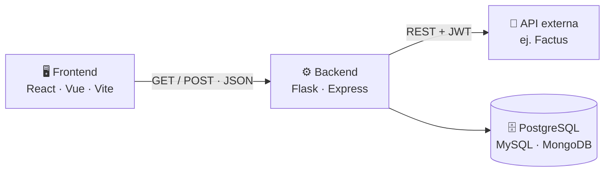

<!-- Reemplaza: TU_USUARIO, TU_PORTAFOLIO y los repos de los proyectos -->

 

---

[**Sobre mí**](#sobre-mi) · [**Stack**](#stack) · [**APIs**](#apis) · [**IA**](#ia) · [**Proyectos**](#proyectos) · [**Contacto**](#contacto)

---

## 👨‍💻 Sobre mí

Soy estudiante de **6.º semestre de Ingeniería de Sistemas** en las **Unidades Tecnológicas de Santander (UTS)**, en Bucaramanga 🇨🇴, con formación técnica en **contabilidad**. Esa mezcla me permite construir software que entiende el negocio: nómina, inventarios, facturación y puntos de venta.

| | |
|---|---|
| 🔭 **Trabajando en** | Sistemas ERP/POS y calculadoras de nómina colombiana |
| 🤖 **Explorando** | IA aplicada, machine learning y ciencia de datos |
| 🔐 **Me importa** | Seguridad: JWT, CSRF, CSP, rate limiting, validación con Zod |
| ☁️ **Aprendiendo** | Despliegue y arquitectura en AWS y Azure |
| 🗣️ **Idiomas** | Español (nativo) · Inglés B2 |

---

## 🛠️ Stack tecnológico

<table>
  <tr>
    <td><b>Lenguajes</b></td>
    <td></td>
  </tr>
  <tr>
    <td><b>Frontend</b></td>
    <td></td>
  </tr>
  <tr>
    <td><b>Backend</b></td>
    <td></td>
  </tr>
  <tr>
    <td><b>Bases de datos</b></td>
    <td></td>
  </tr>
  <tr>
    <td><b>DevOps y nube</b></td>
    <td></td>
  </tr>
  <tr>
    <td><b>Herramientas</b></td>
    <td></td>
  </tr>
</table>

<b>🔎 Ver el detalle completo de habilidades</b>

 

- **APIs:** implementación e integración de APIs REST (como Factus, facturación electrónica), con GET y POST para comunicar frontend y backend
- **Backend:** Python con Flask para web, Node.js, Express.js, API REST, autenticación y autorización con JWT, integración de servicios externos, manejo de archivos
- **ORM y datos:** Sequelize, modelado relacional y no relacional, SQL, ciencia de datos, machine learning
- **Seguridad y calidad:** bcrypt, Helmet, Content Security Policy, protección CSRF, rate limiting, validación con Zod, pruebas de software
- **Infraestructura:** fundamentos de redes, SSH, configuración de servidores, variables de entorno, HTTPS, despliegue de aplicaciones web
- **Complementarias:** IoT, ingeniería inversa, herramientas de IA, sistemas ERP/POS
- **Productividad:** Excel, Word, Canva, Photoshop

---

## 🔌 Integración de APIs REST

Comunico el **frontend con el backend** mediante peticiones `GET` y `POST` en JSON, y conecto el backend con **APIs externas** como las de facturación electrónica (tipo Factus).

| Método | Uso típico |
|---|---|
| `GET` | Consultar datos: listados, facturas, reportes |
| `POST` | Crear o enviar: login, registros, emisión de documentos |

---

## 🤖 IA y herramientas de trabajo

Uso asistentes y modelos de lenguaje para acelerar el desarrollo, **ejecuto LLM en local con Ollama** y trabajo con modelos de **Hugging Face** para proyectos de IA. Documento y organizo mis ideas en **Obsidian**.

---

## 🚀 Proyectos destacados

| Proyecto | Qué resuelve | Tecnologías |
|---|---|---|
| 🐾 **VetPets** | POS y gestión de clínica veterinaria, en expansión a ERP completo | _completa tu stack_ |
| 💰 **NominaApp** | Cálculo de nómina colombiana | Python · Flask |
| 🌐 **Calculadora IPv4** | Subredes IPv4, de CLI a aplicación web desplegada | Python · Flask |

---

## ⚡ Qué puedo hacer por ti

| | Servicio | Cómo lo hago |
|---|---|---|
| 🌐 | **Aplicaciones web full stack** | React o Vue con Vite en el frontend, Node/Express o Flask en el backend |
| 🧾 | **Sistemas ERP y POS** | Inventario, ventas, clientes y reportes, con base de datos relacional |
| 💰 | **Automatización contable y nómina** | Mi formación en contabilidad más Python para cálculos y reportes |
| 🔌 | **Integración de APIs** | REST con GET/POST, autenticación JWT y servicios externos tipo Factus |
| 🤖 | **IA aplicada** | Modelos de Hugging Face, LLM locales con Ollama y machine learning |
| 🔐 | **Seguridad desde el diseño** | bcrypt, Helmet, CSP, CSRF, rate limiting y validación con Zod |
| ☁️ | **Despliegue** | Docker, Linux, SSH, HTTPS, Vercel, AWS y Azure |

---

## 💬 Pregúntame sobre

`Flask` · `API REST` · `JWT` · `PostgreSQL` · `Docker` · `React` · `Ollama` · `Hugging Face` · `Machine Learning` · `Redes y servidores` · `Obsidian` · `Contabilidad para software`

---

## 🌱 Siempre aprendiendo

- ☁️ Arquitectura y despliegue en **AWS y Azure**
- 🧠 Machine learning y ciencia de datos aplicados a negocio
- 🧾 Integración con servicios de facturación electrónica
- 🧰 Flujos de trabajo con asistentes de IA y modelos locales

---

## 🤝 Hablemos

Busco oportunidades de **práctica o primer empleo como desarrollador** y proyectos donde pueda aportar en desarrollo web, automatización contable o IA aplicada.

> _"Primero hazlo funcionar, luego hazlo bien, luego hazlo rápido."_ — Kent Beck

⭐ Si algo de lo que ves te sirve, déjame una estrella.

